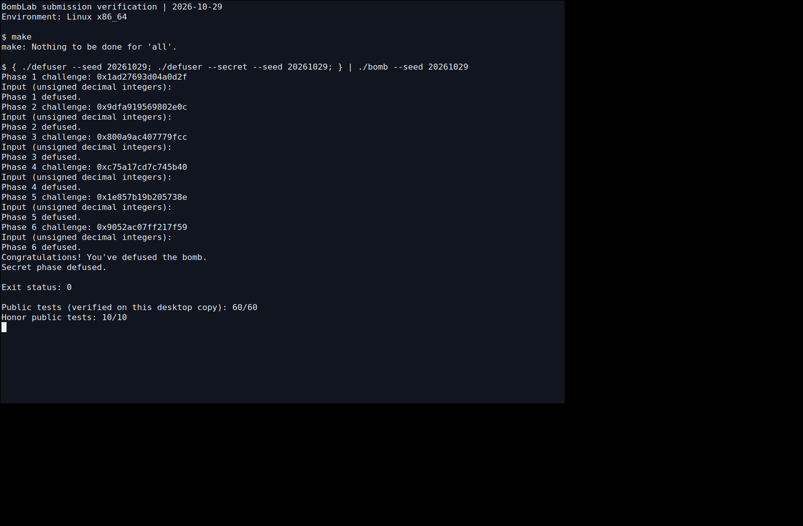

# Bomb Lab 实验报告

整理与验证日期：2026-10-29。

本报告对应仓库内的个人 `bomb`：package ID 为 `334ed3f5d1c9d21cde327a83`，SHA-256 为 `fb827cfc0895ed39cd0fb99878d6e89a23c94b2e022b9f6c321b28680a764179`。解法适用于这个个人版本，不能据此推断其他同学的常量和布局。

本版实现了正式六关和必做 Honor。仅在 `defuser.c` 中实现求解逻辑，接口、驱动、测试、工作流及个人二进制沿用模板。下文依据该二进制的反汇编和实际测试整理；代码、分析、文档和测试操作由 Codex 辅助完成，不将其描述为学生独立推导或已掌握的成果。

阅读导航：[计算约定](#计算约定) → [第一关](#第一关函数调用) → [第二关](#第二关数组与循环) → [第三关](#第三关switch与跳转表) → [第四关](#第四关递归与返回值) → [第五关](#第五关结构体与链表) → [第六关](#第六关函数指针) → [Honor](#honor相邻字段与校验) → [验证](#验证结果)。

## 计算约定

令当前关卡的 64 位输入为 `c`。`u32(x)` 表示仅保留最低 32 位，`^` 为按位异或，右移按无符号数进行。下文每个 32 位中间结果的加减乘、左移均按模 2^32 处理；实现使用 `uint32_t`，避免有符号溢出。

函数入口的 `rdi` 指向口令字符串，`rsi` 保存 challenge；调用内部辅助函数时需要重新按调用位置辨认实参。正式各关输出字段数依次是 1、6、2、1、2、1，使用模板 `write_answer` 格式化为十进制整数。Honor 使用单独的字符串布局。

## 第一关：函数调用

`phase_01` 检查一个无符号整数，调用 `p1_compute` 后将返回值与输入比较。关键辅助函数为：

```asm
p1_step2:  lea (%rdi,%rsi,2),%eax
           xor $0x3ebb,%eax
p1_step0:  xor $0xc25c,%esi
           lea (%rsi,%rdi,4),%eax
p1_step1:  lea (%rdi,%rdi,2),%eax
           add $0x469a,%esi
           xor %esi,%eax
```

`p1_compute` 的实参准备决定了调用关系：先提取 `L=u32(c)`、`H=u32(c>>32)`、`M=u32(c>>16)`；`M` 保留右移后的低 32 位，并非只取 16 位。

```text
A = (H + 2*L) ^ 0x3ebb
B = 4*L + (M ^ 0xc25c)
answer = (3*B) ^ (A + 0x469a)
```

调用顺序为 `p1_step2(H,L)`、`p1_step0(L,M)`、`p1_step1(B,A)`，所以不能仅按函数名里的编号拼接。`lea` 在这里做整数加法和倍数计算，不解引用内存。

## 第二关：数组与循环

首项比较附近的指令为：

```asm
shr $0x2b,%rax
add %eax,%eax
and $0x1e,%eax
add $0x4,%eax
```

因此 `a[0] = 2*((c>>43)&15)+4`。循环从移位量 `0x16=22` 开始，每轮增加 3；`lea (%rdi,%rdi,4),%edi` 表示将前一项乘以 5。

```asm
add $0x1,%esi
lea (%rdi,%rdi,4),%edi
shr %cl,%rax
add $0x3,%ecx
and $0x1f,%eax
xor %esi,%eax
add %edi,%eax
```

恢复为：

```text
a[0] = 2*((c>>43)&15)+4
for i = 1..5:
    fragment = (c>>(22+3*(i-1))) & 31
    a[i] = 5*a[i-1] + (fragment ^ (i+1))
```

第一次循环中 `esi` 已先从 1 加到 2，因此异或的是 `i+1`，不是 `i`。最终按顺序输出六项。

## 第三关：switch 与跳转表

`phase_03` 先检查输入的第一个整数等于 `k=c&7`，再计算 `x=u32(c>>32)^u32(c>>3)`，将第二个整数与分派结果比较。

```asm
402268: cmp $0x7,%eax
40226b: ja 4022b5
40226d: notrack jmp *0x405820(,%rax,8)
```

跳转表包含 8 个 8 字节绝对地址。沿表项和跳板继续追踪，得到实际顺序如下；不能将函数符号后缀当作 selector：

| k | 跳板地址 | 最终函数 | 结果 |
| --- | --- | --- | --- |
| 0 | `0x402288` | `p3_case_0` | `3*x+0x1b0a` |
| 1 | `0x402290` | `p3_case_2` | `5*x+0x2fd` |
| 2 | `0x402298` | `p3_case_7` | `5*x+0x30ad9` |
| 3 | `0x4022a0` | `p3_case_4` | `(4*x)^0x2088` |
| 4 | `0x4022a8` | `p3_case_1` | `(x^0x60bc)+(x>>2)` |
| 5 | `0x4022b0` | `p3_case_3` | `(4*x)^0xbfeb` |
| 6 | `0x402278` | `p3_case_6` | `3*x+0xa7aa` |
| 7 | `0x402280` | `p3_case_5` | `(x^0x8275)+(x>>1)` |

实现用 `switch(k)` 保存上述分支关系，输出 `k` 和计算结果。所有分支均在扩展测试中覆盖。

## 第四关：递归与返回值

入口提取 `target=c&127`、`salt=u32(c>>7)^u32(c>>32)`，以区间 `[0,127]` 调用 `p4_walk`。中点由 `high-low` 右移一位后加 `low` 得到。

```asm
402348: sub %esi,%edi
40234a: shr $1,%edi
40234c: add %esi,%edi
402350: je 4023a0
...
40236c: lea (%rax,%rax,2),%eax
40236f: xor %ebx,%eax
402376: xor $0x19,%eax
...
402394: xor $0x2,%eax
4023a0: lea 0xcb(%rdi),%eax
4023a6: xor %ecx,%eax
```

令 `m=low+((high-low)>>1)`，递归关系为：

```text
F(t,l,h,s):
    m = l + ((h-l)>>1)
    if t == m: return (m+0xcb)^s
    if t < m:  return (3*F(t,l,m-1,s))^(m+s)^2
    otherwise: return (3*F(t,m+1,h,s))^(m+s)^0x19
```

口令是 `F(target,0,127,salt)`。中点、salt 与递归返回值都参与结果，不能仅记录左右分支。`jb` 按无符号数判断左分支。target 总在区间内，递归每次缩小区间，最多 8 次调用到达基例；`m=0` 时不会进入 `t<m` 分支，因而不会执行无效的 `m-1`。

## 第五关：结构体与链表

`p5_traverse` 从地址表 `0x405b60` 选择起点。节点内存读取为：

```asm
mov 0x405b60(,%rax,8),%rdx  # 起点地址
mov 0x8(%rdx),%esi         # tag
add 0xc(%rdx),%eax         # value
mov (%rdx),%rdx            # next
```

可恢复节点的物理布局：偏移 0 为 8 字节 next 指针，偏移 8 为 4 字节 tag，偏移 12 为 4 字节 value，总计 16 字节。代码将 next 指针转换为下表的索引，仅保存二进制中的静态节点数据和连接关系。

| 索引 | 节点地址 | next 索引 | tag | value |
| --- | --- | --- | --- | --- |
| 0 | `0x405ba0` | 9 | 1399 | 15708 |
| 1 | `0x405bb0` | 4 | 100 | 15737 |
| 2 | `0x405bc0` | 10 | 1887 | 17130 |
| 3 | `0x405bd0` | 1 | 2689 | 49663 |
| 4 | `0x405be0` | 6 | 2883 | 42131 |
| 5 | `0x405bf0` | 0 | 1614 | 14186 |
| 6 | `0x405c00` | 7 | 2352 | 18482 |
| 7 | `0x405c10` | 5 | 611 | 31608 |
| 8 | `0x405c20` | 2 | 874 | 15671 |
| 9 | `0x405c30` | 空 | 2106 | 64991 |
| 10 | `0x405c40` | 11 | 258 | 47895 |
| 11 | `0x405c50` | 3 | 1122 | 33207 |

起点索引表为 `[8,2,10,11,3,1,4,6]`。在 `heads[c&7]` 处开始，访问 `1+((c>>3)&3)` 个节点：

```text
v = u32(c>>6) ^ u32(c>>32) ^ 0x40b9
每访问一个节点 p:
    v = (3*v + p.value) ^ p.tag
    last_tag = p.tag
    p = p.next
输出 v, last_tag
```

起点本身先处理一次，再按低两位决定是否继续，所以总次数是 1～4。链条末端不会在允许的组合中提前到达；扩展测试覆盖全部 8×4 个起点与访问次数组合。

## 第六关：函数指针

`p6_dispatch` 从 `0x405e00` 取函数地址并间接调用两次：

```asm
4025b0: and $0x38,%ebx
4025b3: and $0x7,%eax
4025b6: call *0x405e00(,%rax,8)
4025bd: xor $0x6d14,%eax
4025c4: call *0x405e00(%rbx)
4025cf: add $0x3b26,%eax
```

函数表的实际顺序是 `[op5,op2,op1,op0,op2,op4,op3,op3]`，存在重复项。六个运算如下，其中 `rol32/ror32` 表示 32 位循环移位：

| 函数 | 运算 |
| --- | --- |
| op0 | `rol32(x,3)^0xc2fa` |
| op1 | `ror32(x,7)` |
| op2 | `(x^0x3900)+4*x` |
| op3 | `((x<<5)+0x3905)^(5*x)` |
| op4 | `(x+0x8a65)^(x>>3)` |
| op5 | `(x^(x>>3))+0x5a48` |

op2 的 `xor $0x39,%ah` 修改 eax 的第 8～15 位，因此对应 `x^0x3900`。总结果为：

```text
x = u32(c>>6)^u32(c>>32)
i = c&7
j = (c>>3)&7
answer = table[j](table[i](x)^0x6d14)+0x3b26
```

第二次调用用 `c&0x38` 直接形成字节偏移，等价于先求 j 再乘 8。实现保留两次调用的先后顺序，并覆盖了全部 64 对表项组合。

## Honor：相邻字段与校验

`secret_gate` 的复制起点是 `rbp-0xd0`，检查位置为 `rbp-0xb0`，传给 `secret_phase` 的字符串从 `rbp-0xac` 开始：

```asm
40274b: lea -0xd0(%rbp),%r12
402771: sub $0x24,%rax
402775: cmp $0x7f,%rax
402779: jbe 402790
402796: call secret_copy
40279b: cmpl $0x4e45504f,-0xb0(%rbp)
4027ad: lea -0xac(%rbp),%rdi
4027b4: call secret_phase
```

两处差值分别是 32、36 字节。按小端序，`0x4e45504f` 的内存字节为 `4f 50 45 4e`，即 `OPEN`。长度范围是 36～163 个字符，零结尾复制也计入局部对象可用空间。构造形式为：

```text
32 个 A + OPEN + selector + 空格 + second + 空格 + third
```

该形式在规定的局部对象内覆盖相邻字段，不修改返回地址，也不注入代码。最长生成行为 59 字符（另有末尾零字符），在 gate 允许范围内。

令 `C` 为 Honor challenge，`T` 为前六关口令经驱动的 `transcript_context` 生成的 64 位 context：

```text
k = u32(T)&3
A = u32(C)^u32(C>>32)
B = u32(T)^u32(T>>32)
second = ror32(A^B,7)^0x23a3^(k*0x5805)^u32(T>>16)
third = second^(B+k+0x7ba6+(A>>7))
```

`secret_phase` 分别比较这三个整数；`secret_mix` 对应循环右移 7 位后异或 `0x23a3`。实现直接使用传入 context，不将某个 seed 的 context 写死。验证时前六行和 Honor 必须使用相同 seed，并送入同一次完整 bomb 运行。

## 验证结果

环境为 WSL Ubuntu、Linux x86_64，GCC 按模板 `-std=c11 -O2 -Wall -Wextra -Wpedantic -Werror` 编译成功。2026-10-29 在桌面提交副本重新编译并运行公开测试，正式六关共 60/60、Honor 10/10 通过。`public_test.py` 默认已包括 Honor，`--secret` 可单独复核 Honor。

同一解法和同一 bomb 在备用阶段完成了下列扩展检查，整理提交包时核对 SHA-256 一致；原始测试记录保存在本地学习档案，不将整份调试日志放入提交仓库：

| 检查 | 结果 | 覆盖目的 |
| --- | --- | --- |
| 第一关直接 challenge | 204/204 | 低位、高位、单比特、随机输入 |
| 第二关直接 challenge | 204/204 | 移位片段与递推 |
| 第三关直接 challenge | 204/204 | 8 个 selector 全覆盖 |
| 第四关直接 challenge | 332/332 | 128 个 target 全覆盖 |
| 第五关直接 challenge | 236/236 | 32 个起点/步数组合全覆盖 |
| 第六关直接 challenge | 268/268 | 64 对函数选择全覆盖 |
| 公开列表以外的完整六关＋Honor | 128/128 | 相同 seed 的完整输入链 |
| 输出容量及边界检查 | 80955 项 | cap 0～256、哨兵检查、ASan/UBSan 无报告 |

这些是已执行测试的范围，不等于取得了助教隐藏测试成绩。

公开列表以外的 seed `20261029` 的结果如下，六关与 Honor 在同一次运行中全部通过，故每个已完成关卡都有非公开 seed 验证记录：

| 关卡 | challenge | 输出口令 |
| --- | --- | --- |
| 1 | `0x1ad27693d04a0d2f` | `2622955666` |
| 2 | `0x9dfa919569802e0c` | `8 44 243 1233 6180 30903` |
| 3 | `0x800a9ac407779fcc` | `4 18686928` |
| 4 | `0xc75a17cd7c745b40` | `3507382101` |
| 5 | `0x1e857b19b205738e` | `985186108 2352` |
| 6 | `0x9052ac07ff217f59` | `1932961906` |

Honor 第七行：

```text
AAAAAAAAAAAAAAAAAAAAAAAAAAAAAAAAOPEN0 4253943975 3933565719
```

复现命令（在 Linux/WSL 仓库目录内执行）：

```bash
make
python3 public_test.py
./defuser --seed 20261029 > /tmp/bomblab-submission-input.txt
./defuser --secret --seed 20261029 >> /tmp/bomblab-submission-input.txt
./bomb --seed 20261029 < /tmp/bomblab-submission-input.txt
```

下图是桌面副本在 Xvfb 内真实 xterm 终端中执行上述完整输入链的截图，没有把文字绘制成终端图片：



## 资料与辅助工具

- [课程 Lab2 说明](https://ics-26fall-fdu.github.io/labs/lab2-bomb-lab/)：接口、提交文件、报告和标签要求。
- [课程 BombLab 模板](https://github.com/ICS-26Fall-FDU/BombLab)：公共驱动、测试与教学例子。
- GNU objdump、GDB：读取该个人二进制的指令和数据表，未用 GDB 改动 bomb 的变量、寄存器或内存。
- GCC、Python、AddressSanitizer、UndefinedBehaviorSanitizer：编译、调用实际 bomb 校验与输出缓冲区检查。
- Codex：辅助恢复计算关系、实现完整求解代码、编写测试与文档、整理仓库。本文如实记录工具完成的工作，不代表学生已经独立理解这些内容。
